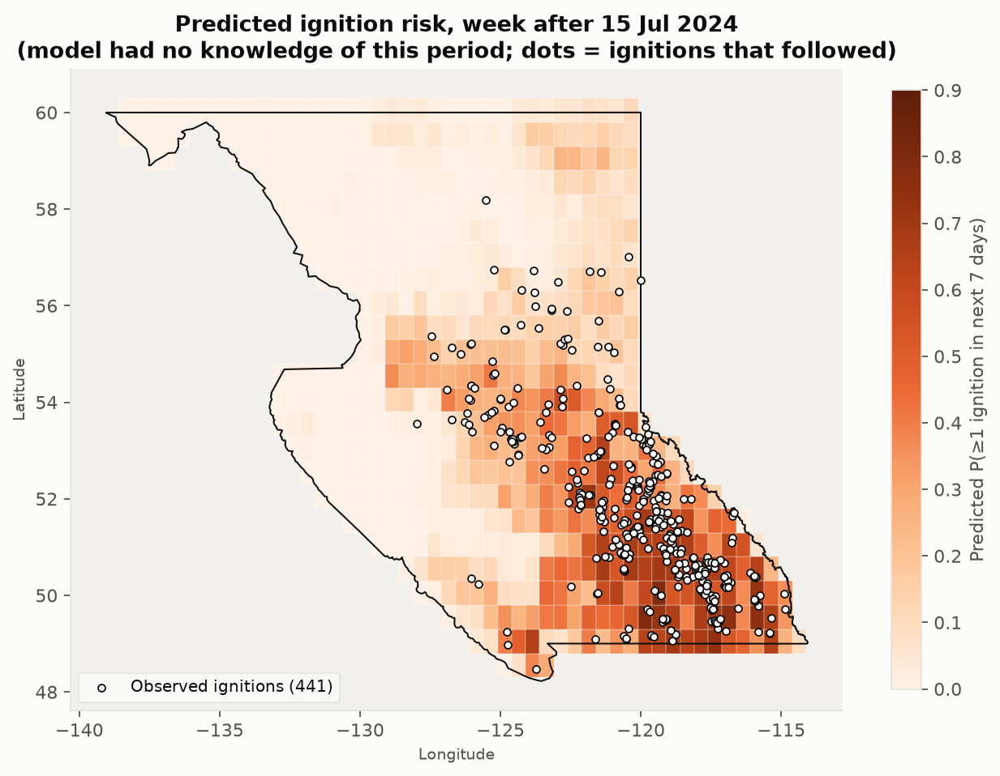
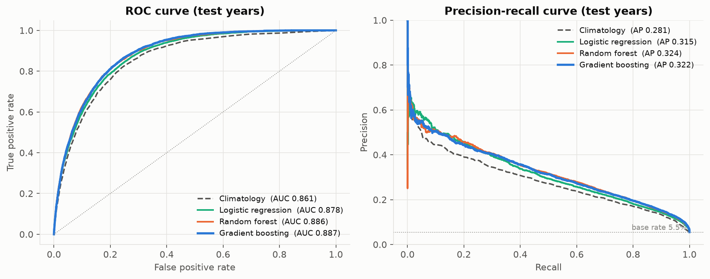
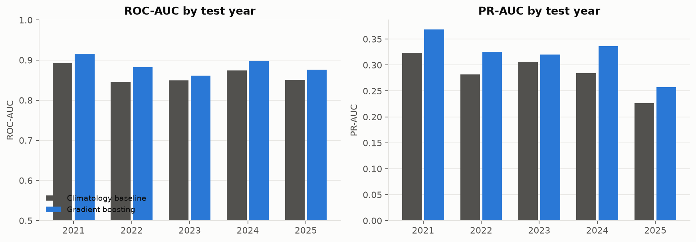
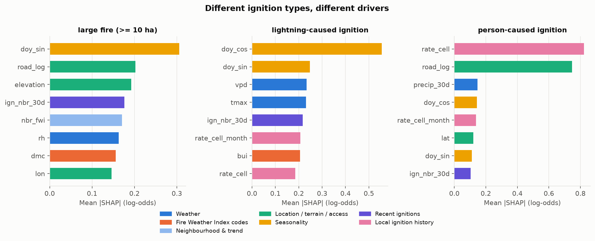
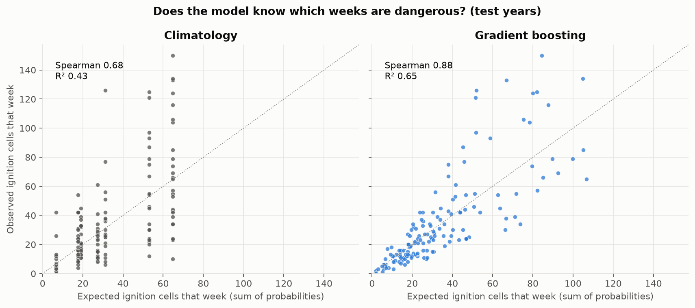
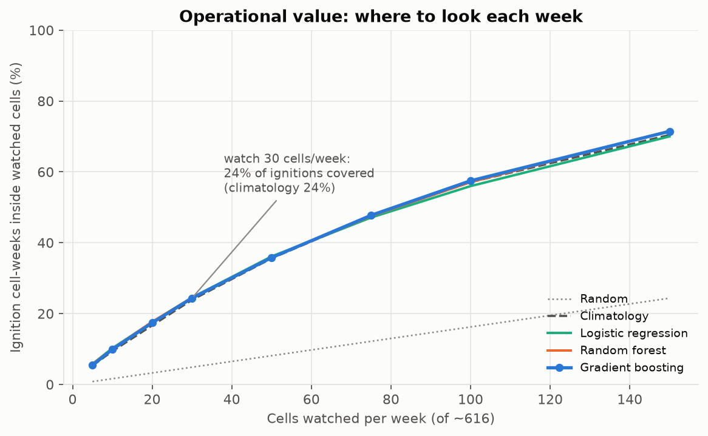
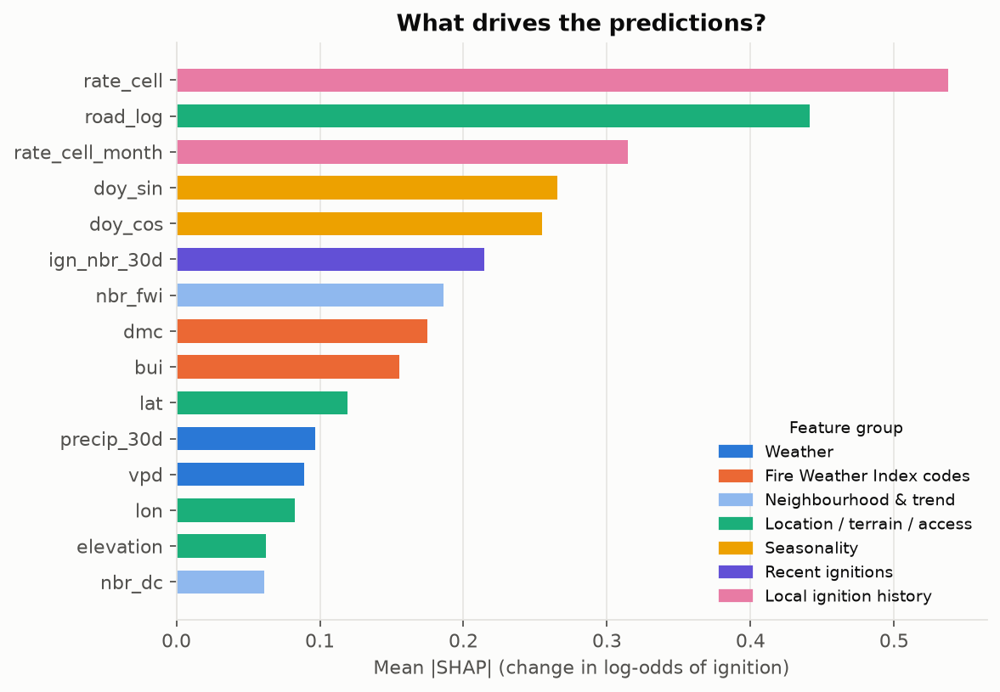
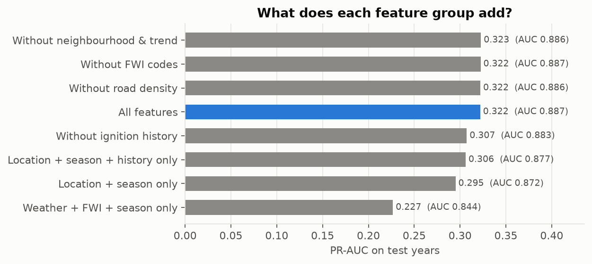

# Wildfire Ignition Risk for British Columbia

Weekly, grid-cell wildfire **ignition risk** for British Columbia, built from open weather data, the Canadian Fire Weather Index (FWI) System, road access and 20 years of agency ignition records. Four targets (any ignition, large fire, lightning-caused, person-caused), evaluated the way they would actually be used: on **future years the model never saw**, against a **strong climatology baseline**, with an honest account of what the model does and does not add.



*Predicted probability of at least one ignition in each ~0.5° cell during the 7 days after 15 Jul 2024 (a held-out test year). Dots are the 441 ignitions that followed. [Interactive version](reports/risk_map_peak_week.html).*

## The question

> For each grid cell and each week of the April–October season: **will at least one wildfire ignite in that cell in the next 7 days?** (And of which kind: large, lightning-caused, person-caused?)

616 cells (0.5° ≈ 55 × 30–35 km) × 31 weeks × 21 years = **401,016 cell-weeks**, 5.0% of which contain an ignition.

## Results (held-out test years 2021–2025)

Training uses 2005–2018, model selection uses 2019–2020, and everything below is scored on 2021–2025 (95,480 cell-weeks, including the extreme 2021 and 2023 seasons). The split is strictly chronological.

### Any ignition

| Model | ROC-AUC | PR-AUC | Brier skill | Ignitions caught in top 5% of risk | Lift @ top 5% |
|---|---|---|---|---|---|
| Climatology (cell × month historical rate) | 0.861 | 0.281 | 0.142 | 31.1% | 6.2× |
| Logistic regression | 0.878 | 0.315 | 0.160 | 34.1% | 6.8× |
| Random forest | 0.886 | 0.324 | 0.174 | 34.6% | 6.9× |
| **Gradient boosting** (deployed) | **0.887** | **0.322** | 0.170 | **34.6%** | **6.9×** |



- **The baseline is already strong.** Knowing *where and when* fires usually happen gets ROC-AUC 0.861. (The first version of this project reported ~0.91 on synthetic data and compared against nothing.)
- **The improvement is real but modest.** A cluster bootstrap over prediction dates (200 resamples) gives gradient boosting **+0.026 ROC-AUC (95% CI 0.020–0.033)** and **+0.041 PR-AUC (95% CI 0.020–0.062)** over climatology, and it wins in each of the five test years.
- **Probabilities are usable.** Expected calibration error is 0.006: when the model says 30%, about 30% of those cell-weeks see an ignition.
- **A negative result, kept on purpose.** Isotonic recalibration fitted on the 2019–20 validation years *hurt* test performance (ECE 0.006 → 0.018): those years were quiet and the test years were not. The raw model was already calibrated, so that is what is deployed.



### Four targets

| Target | Test base rate | ROC-AUC clim → model | Δ ROC-AUC (95% CI) | PR-AUC clim → model |
|---|---|---|---|---|
| Any ignition | 5.5% | 0.861 → **0.887** | +0.026 (0.020–0.033) | 0.281 → 0.322 |
| Large fire (≥ 10 ha) | 1.0% | 0.788 → **0.855** | +0.068 (0.042–0.094) | 0.047 → 0.062 |
| Lightning-caused | 3.2% | 0.885 → **0.914** | +0.029 (0.021–0.039) | 0.234 → 0.275 |
| Person-caused | 2.4% | 0.871 → **0.906** | +0.035 (0.026–0.042) | 0.177 → 0.204 |

Weather matters most where climatology is weakest: **large fires**, which are rare and strongly weather-driven, gain the most. Each target has its own local-history rates and its own drivers:



By SHAP importance, person-caused ignitions lean on **road access** and local history, while lightning-caused ones lean on season, vapour-pressure deficit and temperature. That separation is physically sensible and is the main reason to model causes separately (SHAP importance describes what the model uses, not how much each feature adds to accuracy; see the ablation below).

### What the model is good at, and what it is not



**The model's skill is mostly about *when*, not *where within a week*.**

- **Timing: strong.** Across the province, the model tracks week-to-week swings in the number of ignition cells (Spearman **0.88**, R² 0.65) far better than climatology (0.68, R² 0.43), which can only predict a constant per month. For person-caused ignitions the gap is 0.69 vs 0.34.
- **Ranking cells within a week: no better than climatology.** If crews could only watch the K highest-risk cells in a given week, the model covers about the same share of ignitions as climatology:



| Cells watched per week (of 616) | Climatology | Gradient boosting | Random |
|---|---|---|---|
| 10 | 9.4% | 9.9% | 1.6% |
| 30 | 23.9% | 24.4% | 4.9% |
| 50 | 35.6% | 35.8% | 8.1% |
| 100 | 57.1% | 57.5% | 16.2% |

(Person-caused is the exception: at 30 cells/week the model covers 39.2% vs 36.5% for climatology.) The pooled "top 5%" advantage in the table above therefore comes mainly from knowing *which weeks* are active. Better spatial ranking would need information the model does not have yet: lightning strikes, fuel condition, local weather.

### What actually drives the predictions





| Feature set (re-trained, scored on test years) | PR-AUC | ROC-AUC |
|---|---|---|
| All features | 0.322 | 0.887 |
| Without neighbourhood & trend features | 0.323 | 0.886 |
| Without road density | 0.322 | 0.886 |
| Without FWI codes | 0.322 | 0.887 |
| Without ignition history | 0.307 | 0.883 |
| Location + season + history only (no weather) | 0.306 | 0.877 |
| Location + season only | 0.295 | 0.872 |
| Weather + FWI + season only (no location) | 0.227 | 0.844 |

- Most skill comes from **local ignition history and seasonality**; weather and FWI add a small, consistent increment (PR-AUC 0.306 → 0.322).
- **Features that did not help:** the FWI codes (redundant with the raw weather that produced them), road density, and the neighbour-cell/trend features each change PR-AUC by ≤ 0.001 for "any ignition". I also checked them on every target with a fixed-iteration comparison ([reports/targets.json](reports/targets.json), `new_features`): road density + neighbourhood/trend features move ROC-AUC from 0.886 → 0.887 (any), 0.850 → 0.855 (large fire), 0.915 → 0.914 (lightning) and 0.905 → 0.906 (person), all within noise. Road density is a top SHAP driver for person-caused ignitions, but SHAP shows reliance, not incremental skill: it is largely redundant with a cell's own ignition history. They are kept because they cost nothing and aid interpretation, not because they improve scores.
- **Hyperparameters barely matter.** A 14-configuration search with forward-chaining CV by year ([reports/tuning.json](reports/tuning.json)) found validation log-loss between 0.1345 and 0.1356 for every configuration. The best was adopted but did not move the test score.
- **Spatial generalisation:** holding out whole 2° × 2° blocks (5-fold, per-cell history features removed), the model reaches ROC-AUC 0.893 ± 0.021 versus 0.673 for a no-local-history climatology, so it is not just memorising cells.

## Why these design choices

The first version of this repo trained a Random Forest on **synthetic data whose label was a formula of its own input features**, so its AUC measured how well a forest recovers a rule I had written, and its "inland risk is higher" map came from uniformly random coordinates. The current version fixes the problems that mattered:

| Problem | Fix |
|---|---|
| Synthetic data, circular labels | Real labels: BC Wildfire Service ignition records (34k agency-confirmed wildfires, 2005–2025). Nuisance fires, smoke chases and field activity excluded; typo'd dates removed |
| Satellite hotspots only exist where there *is* fire (no negatives) | Cell-week framing: every cell-week without an ignition is a genuine negative |
| `brightness`/`FRP`/`confidence` only exist once a fire is burning | Removed. Features are pre-ignition conditions only |
| Random train/test split leaks neighbouring places and times | Chronological split + spatial-block CV; date-clustered bootstrap CIs |
| No baseline | Climatology baseline, logistic regression, random forest, gradient boosting |
| ROC-AUC alone flatters a 5% positive rate | PR-AUC, Brier skill, calibration (ECE), top-k capture, **within-week** capture and temporal skill |
| Preprocessing fitted on all data | Local-history features fitted on training years only, leave-one-year-out for training rows, target-specific |
| No tests | 26 tests, including that **features at date *t* cannot see anything after *t*** and that labels cover only days *t+1…t+7* |

## Data

| Role | Source | Notes |
|---|---|---|
| Labels | BC Wildfire Service historical incident locations (BC Data Catalogue, “Fire Incident Locations – Historical”) via open WFS | Open Government Licence – BC. No API key. Cause and final size give the four targets |
| Weather | [NASA POWER](https://power.larc.nasa.gov/) daily point API (MERRA-2 reanalysis): max temperature, dew point, precipitation, max wind; also supplies elevation | Open, no key. ~0.5° × 0.625° native resolution |
| Human access | BC Digital Road Atlas segment counts per cell via WFS `resultType=hits` | A relative proxy (digitising detail varies), log-scaled |
| Boundary | BC provincial boundary, BC Data Catalogue | Used to select cells and draw maps |
| Optional labels | [NASA FIRMS](https://firms.modaps.eosdis.nasa.gov/api/area) satellite hotspots (`label.source: firms`) | Needs a free `FIRMS_MAP_KEY`. Implemented but **not exercised in this repo's results or tests**; includes non-wildfire heat sources |

## Quick start

```bash
python -m venv .venv && source .venv/bin/activate
pip install -e ".[app,dev]"

make data      # ~5-10 min first time: boundary, ignitions, weather and road counts for 616 cells -> data/
make tune      # optional: forward-chaining hyperparameter search (~15 min) -> reports/tuning.json
make train     # fits all four targets, evaluates on held-out years
make report    # figures, SHAP, maps -> reports/
make export    # small artefact bundle for the app -> artifacts/
make app       # Streamlit explorer
make test
```

Equivalent CLI: `python -m wildfire.cli {fetch,build,tune,train,report,export,live,all}`. Everything is configured in [configs/default.yaml](configs/default.yaml).

The Streamlit app and the committed `artifacts/` bundle (≈7 MB) run from a fresh clone without re-downloading data. The notebook [notebooks/walkthrough.ipynb](notebooks/walkthrough.ipynb) walks through the results, and [docs/MODEL_CARD.md](docs/MODEL_CARD.md) summarises intended use and limitations.

### Interactive app

- **Back-test explorer**: pick a target, slide through any held-out week, compare the model to climatology against what actually ignited, and play the **crew-allocation game** (how many events do you cover if you can only watch K cells?).
- **Live nowcast**: scores every cell from the latest NASA POWER weather and newest BCWS records for any target, with a per-cell SHAP explanation. NASA POWER lags real time by about 3 days and rate-limits requests, so a first run takes a few minutes and the output is a **nowcast for the 7 days after the latest observation, not a weather forecast**.

## Project layout

```
wildfire/            package
  grid.py            BC boundary + regular grid clipped to it
  ignitions.py       BCWS (and optional FIRMS) loaders, cleaning
  weather.py         NASA POWER client (retries, backoff, resumable)
  human.py           road-density access proxy
  fwi.py             Canadian FWI System (Van Wagner 1987), vectorised across cells
  features.py        daily features -> weekly rows, targets, timing contract, local-history encoder
  models.py          climatology baseline, sklearn models, year-based iteration selection
  tune.py            forward-chaining CV hyperparameter search
  train.py           training for all targets
  evaluate.py        metrics, bootstrap, spatial CV, ablation, weekly top-K, temporal skill
  explain.py         SHAP (permutation explainer, works for any sklearn model)
  plots.py maps.py   figures and Folium maps
  live.py            nowcast
  cli.py             command line
app/streamlit_app.py interactive explorer
configs/             experiment configuration
tests/               pytest suite
artifacts/           committed, app-ready models + grid + test predictions
reports/             metrics, tuning, figures, interactive HTML maps
docs/MODEL_CARD.md   intended use, performance, limitations
notebooks/           executed walkthrough
```

## Limitations

- **Missing drivers.** Lightning occurrence is the dominant natural ignition cause in BC and is not in the features (lightning-caused ignitions are predicted from weather proxies only). Fuel type/NDVI and snowpack are also absent. These are the most likely sources of better *spatial* ranking.
- **Coarse weather.** Reanalysis at ~50 km smooths local extremes (convective storms, valley winds). FWI inputs are daily max temperature, dew-point-derived humidity and max wind rather than true noon observations, so the codes run slightly "hot and dry". April FWI start-up ignores snowpack at high elevation.
- **Label effects.** Records reflect where crews are dispatched and what is reported; practice changes over 20 years. "Any ignition" is mostly tiny fires; "large fire" has few positives (1% of cell-weeks), so its intervals are wide.
- **Short, non-stationary test window.** Five test years with strong year-to-year variation, and a warming climate means the future may not resemble 2005–2018. Reported intervals reflect sampling over dates, not this structural uncertainty.
- **Grid cells are not equal-area** (0.5° of longitude is narrower at 59°N than at 49°N). Road counts are a relative proxy.
- **Not an operational tool.** This is a research / portfolio project. Do not use it for safety decisions; use [BC Wildfire Service](https://www2.gov.bc.ca/gov/content/safety/wildfire-status) information.

## Next steps

1. **Lightning**: the clearest gap. ERA5 convective indices (CAPE) as a proxy, or strike data if accessible, aimed at spatial ranking within a week.
2. Fuel/vegetation (MODIS NDVI/EVI, BC fuel types) and snow cover.
3. Move from nowcast to forecast: NWP forecast weather and re-validation (reanalysis → forecast domain shift).
4. Larger-fire severity targets (e.g. ≥ 100 ha) once there is enough data to evaluate them.
5. Sequence / spatial deep models (ConvLSTM on gridded weather) only if they clear a gap over boosted trees.

## Tech

Python · pandas · NumPy · scikit-learn (HistGradientBoosting, random forest, logistic regression) · SHAP · GeoPandas / Shapely · Folium · Streamlit · pytest · GitHub Actions · ruff
